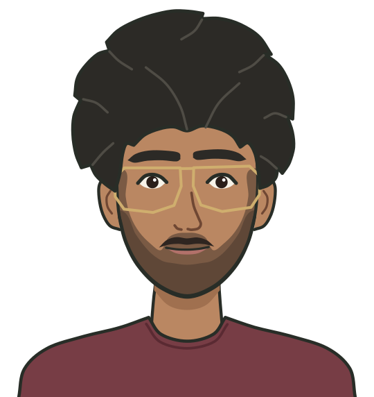
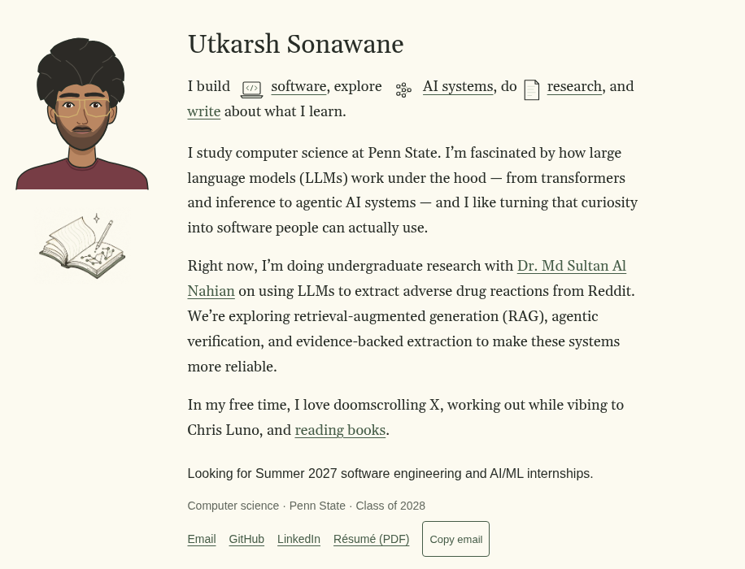
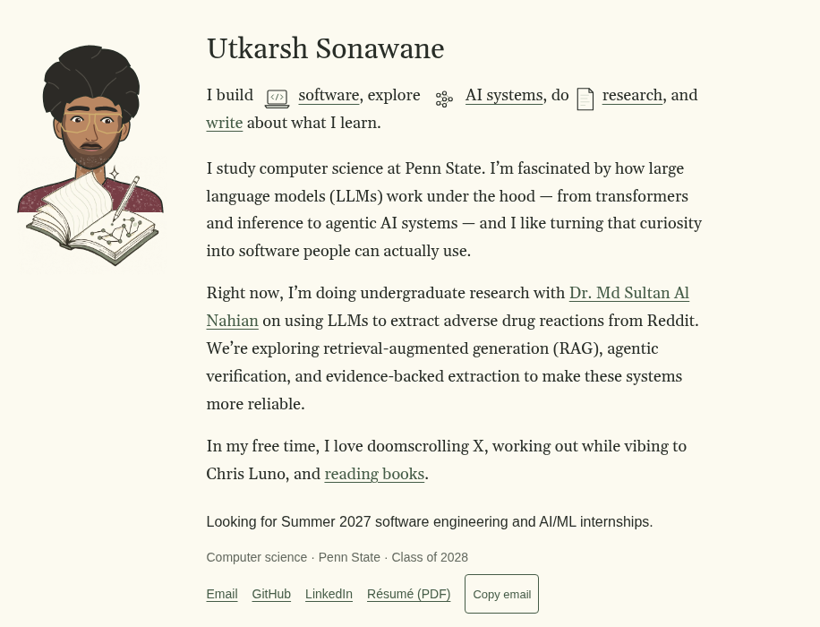
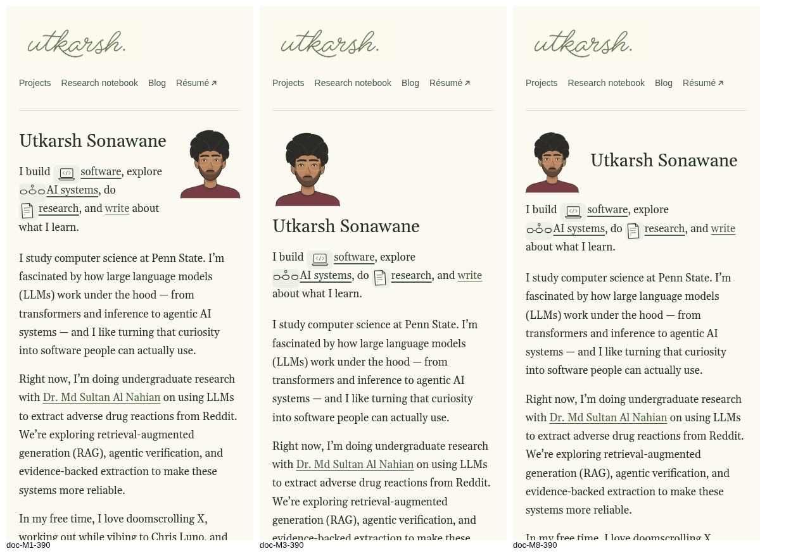
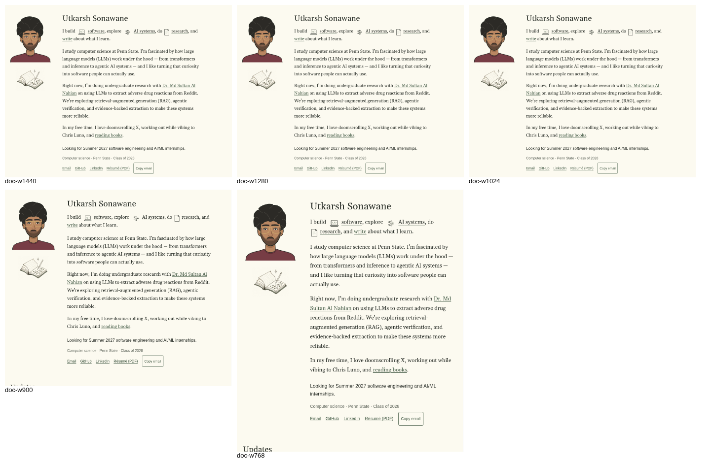
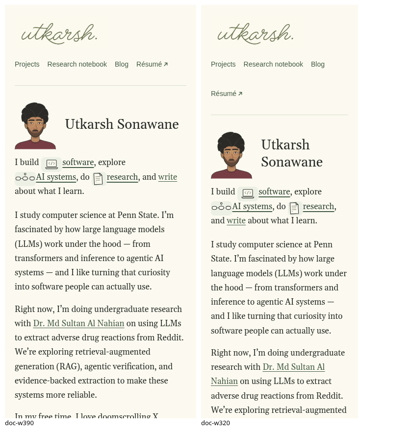
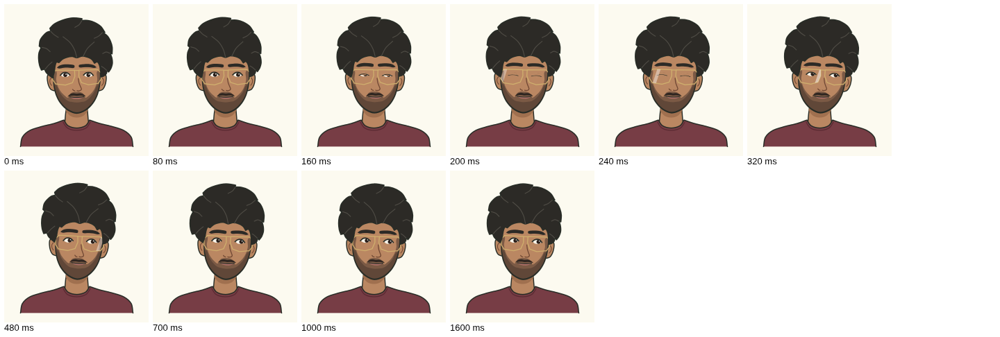
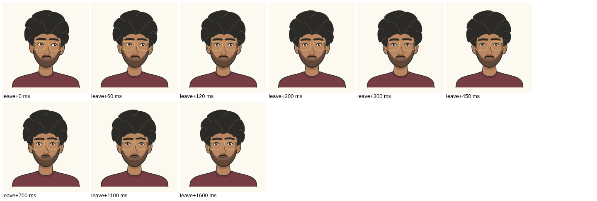

# Illustrated self-portrait

A small animated character of Utkarsh at the start of the homepage
introduction. It is an original vector drawing, inline in `index.html`, with
a vanilla ES module (`js/portrait.js`) that uses the existing springs in
`js/motion.js`. There is no framework, animation library, raster image,
video or extra request.

| File | What changed |
| --- | --- |
| `index.html` | The inline `<svg class="portrait">` replaces the commented-out portrait placeholder in `.intro-art`; one `modulepreload` for `js/portrait.js` |
| `js/portrait.js` | New. Hover, tracking, blink, glint, touch greeting, reduced motion |
| `js/home.js` | Calls `initPortrait()` |
| `css/interactive.css` | Portrait size and placement; the notebook drawing becomes the smaller one; the phone byline |
| `tests/e2e/run.mjs` | New `portrait` suite |
| `tests/e2e/firefox.mjs` | Portrait smoke checks |
| `docs/portfolio-v3/portrait/` | This design record: `portrait.svg` (a copy of the drawing for viewing), the composition experiments and motion frames |

`styles.css`, `hero-icons.js`, `motion.js`, the project previews, all
writing, `content/`, `.publishing/`, the publishing scripts and both
workflows are unchanged.

## The drawing

The reference screenshot set the style: a bust with clean dark outlines,
flat colors, simple features and no frame. The two photographs set the
likeness. They were used only while drawing; they are not in the repository
and are not deployed.



| Trait in the photos | In the drawing |
| --- | --- |
| Thick, voluminous, wavy dark hair, widest at the temples | Nine locks, each a convex wave ending in a soft tip that points along the flow; small notches where one lock tucks under the next; a few lighter lines for the waves |
| Large, thin, angular metal glasses, a little wider than the face | Gold `#cfae6e` hairline frames, angular lenses with a straight top bar, slightly overhanging the face on both sides |
| Prominent eyebrows | Thick, nearly level brows, heavier at the inner end |
| Dark expressive eyes | Almond eye whites with large dark irises and a small highlight; a heavier upper lid line |
| Short beard and moustache | Two-tone beard: lighter stubble on the cheeks, denser on the jaw and chin; a separate moustache over a full lower lip |
| Facial proportions | Measured from the front photo: brows, eyes, nose base, mouth and chin lines; hair about 1.4 × the face width |
| Natural medium-brown skin | Flat `#ba8762`, one flat shadow under the jaw |
| Maroon t-shirt in both photos | Muted `#773d45` crew neck |

Hand-drawn quality comes from small irregularities instead of texture: the
outlines carry a slight wobble, the jaw line swells and tapers like a brush
line, the right brow sits a little higher, the glasses are 0.8° crooked and
one mouth corner is higher. There are no filters, gradients or noise. The
outline color is the site's ink (`#282d27`).

**Structure.** Every part that moves is its own group, so it can move on
its own:

```
svg.portrait (role="img", aria-label="Illustrated portrait of Utkarsh Sonawane")
├── defs: face, eye and lens shapes (reused with <use>), clip paths
├── g.pt-body          neck, shadow, shirt          (still)
└── g.pt-head          tilts about the neck
    ├── g.pt-ears
    ├── g.pt-face      skin, g.pt-beard (clipped to the face), outline
    ├── g.pt-features  drifts with the gaze
    │   ├── path.pt-nose, g.pt-mouth (lip, path.pt-moustache)
    │   ├── g.pt-eyes  2 × g.pt-eye: eye white, g.pt-pupil, use.pt-lid (clipped), path.pt-lash
    │   ├── g.pt-brows 2 × path.pt-brow
    │   └── g.pt-glasses frames, path.pt-glint (clipped to the lenses)
    └── g.pt-hair      sways about the crown
```

**Size.** 10.1 KB of markup, 3.6 KB gzipped, in a 200 × 212 viewBox.
Path data uses relative commands with one decimal, and the face, eye and lens
outlines are drawn once and reused.

## Placement

Two compositions were tried at 1440 px before choosing.

| A. Portrait first (chosen) | B. Integrated notebook |
| --- | --- |
|  |  |

In **B** the character sits behind the notebook and glances down at it. The
notebook is a textured pencil drawing with its own paper background, so over
the shirt it reads as a pasted rectangle, and the two drawing styles clash
where they touch. **A** keeps each drawing whole: the portrait leads the
left column at 180 px with its hair level with the name, and the notebook
sits 22 px below it at 120 px (it was 180 px). It is the simpler option and
matches the editorial layout, so A is used. Nothing has a border or card.

**Phones.** The two-column intro becomes one column below 720 px. Three
arrangements were compared at 390 px (the notebook stays after the contact
links in all three, as before):



- *Float right* (left): the name wraps to two lines and the lede wraps
  around the drawing; at 320 px "I build" stands alone on a line.
- *Above the name* (middle): clean, but the biography starts about 135 px
  lower.
- *Byline* (right, chosen): a 92 px portrait beside the name. The lede
  starts 112 px below the top of the introduction instead of 51 px, so the
  biography moves down about 60 px. At 320 px the name wraps to two lines
  beside the portrait, which still reads as a byline.

Final layout at the seven tested widths:





These local renders use Gelasio and Arimo, which are metric-compatible with
Georgia and Arial, so line breaks match most visitors' screens. The CI
screenshots in `screenshots/portrait-*.png` use the runner's DejaVu fonts.

## Interaction

| Input | What happens |
| --- | --- |
| Page at rest | Neutral drawing. No timers, no frame loop |
| Mouse or pen enters the drawing | The pupils turn toward the pointer at once, the head starts to tilt toward it 70 ms later (2–3°), the hair follows 90 ms after the head and swings a little past, the brows lift. A blink starts at 120 ms (75 ms closing, 40 ms closed, 140 ms opening) and a glint crosses both lenses from 80 ms (560 ms) |
| Pointer moves over it | The gaze follows within the eye. The features drift up to 1.2 units with the gaze, as a hint of a turn. The head leans to the pointer's side, with a dead zone in the middle so it does not flip back and forth |
| Pointer stays still | Everything settles and the frame loop stops. The brows relax to a third of their lift. A timer starts another blink every 4–6.5 s |
| Pointer leaves | Every spring returns to zero with its velocity kept, so leaving mid-motion turns around smoothly. The last frame writes back the drawing's own attributes exactly |
| Touch screen | One greeting the first time the portrait is on screen: a glance toward the name, a blink and the glint, then back to rest after about 1.2 s. A tap on the portrait plays it again (at most every 1.6 s). There are no touch or wheel listeners and nothing calls `preventDefault`, so scrolling and links are unaffected |
| `prefers-reduced-motion: reduce` | Nothing moves. Turning the preference on during an animation drops straight to the rest drawing |
| Keyboard | Nothing to focus: the portrait is a named image, not a control |
| No JavaScript | The same drawing, pixel for pixel (checked by the test suite) |

Bounds, in viewBox units (the eye white is 14 × 6.8): pupils move at most
2.4 sideways and 1.2 up or down; the whole head shifts about 1 unit at most. Tilt targets are
2–3°; spring overshoot brings the measured peak to about 3.3°. The test
fails above 4°.

| Spring | Stiffness / damping | Damping ratio | Drives |
| --- | --- | --- | --- |
| Gaze (x, y) | 240 / 24 | 0.77 | Pupils, features, head lean |
| Tilt | 120 / 14 | 0.64 | Head rotation |
| Hair | 70 / 7.5 | 0.45 | Hair rotation relative to the head |
| Brows | 190 / 17 | 0.62 | Brow lift, small head and hair lift |

The blink and the glint are short timed curves rather than springs, because
each is a fixed gesture. Every part moves by an SVG `transform` attribute,
and the glint also by `opacity`, so the page layout never changes.

Motion frames at 1440 px (each frame is a fresh load, frozen at that time):





## Performance

Local server, no throttling, cache disabled (`tests/e2e/perf.mjs`, three
runs each; sizes are uncompressed transfer).

| `/` | `main` (208adcb) | This branch |
| --- | --- | --- |
| Transfer | 497.3 KB, 16 requests | 520.1 KB, 17 requests |
| JS | 64.1 KB | 76.8 KB |
| CSS | 26.7 KB | 27.5 KB |
| Images | 378.8 KB | 378.8 KB |
| First contentful paint | 48–52 ms | 52–56 ms |
| DOMContentLoaded | 55–57 ms | 59–60 ms |
| `requestAnimationFrame` calls in 2 s idle | 0 | 0 |

Gzipped, the portrait adds 3.4 KB of HTML, 4.4 KB for `js/portrait.js` and
0.3 KB of CSS. One full hover (enter, sweep across, leave, settle: 207
frames over about 3.4 s) cost 21 ms of script, 15 ms of style and 9 ms of
layout in total, which is about 0.1 ms of script per frame. The layout work
is SVG-internal; the measured cumulative layout shift is 0 at load and after
the interaction.

## Tests

`node tests/e2e/run.mjs portrait` (43 checks, also part of the full run):

- Inline SVG named as an image, every animated part present as its own
  group, vector only, not focusable, under 12 KB, no request of its own.
- Renders identically with JavaScript disabled.
- Hover: tilt toward the pointer between 2° and 4°; the pupils turn toward
  it; the eyes move before the head; the hair lags and then catches up; one
  blink; a glint that fades to 0; the text does not move.
- Bounded tracking at the four corners; tilt never over 4°.
- Exact return to the rest attributes after leaving; no frames afterwards or
  while the pointer is still.
- Three quick in-and-out passes while the head is moving: no jumps (maximum
  rate and the step at each exit are checked).
- The hero icons still light, and their card never covers the portrait.
- Reduced motion: hovering writes nothing and requests no frames.
- Touch (390 px, emulated): greets once on load and returns to rest; a swipe
  that starts on the portrait scrolls the page; a tap greets again without
  navigating.
- Layout at 1440, 1280, 1024, 900, 768, 390 and 320 px: size, inside the
  viewport, clear of the biography, the hero icons and the notebook, no
  horizontal overflow; on phones the lede starts within 120 px of the
  introduction and the notebook stays after the contact links.

`tests/e2e/firefox.mjs` adds: drawn inline at 180 px, notices a mouse
pointer (tilt 2–4°, pupils turn), springs back to the rest drawing, no
console errors.

## Limitations

- Tested in Chrome locally and in CI, and in Firefox in CI only (no Firefox
  in the build sandbox). Firefox checks use script-dispatched pointer
  events. Safari/WebKit was not tested, as for the rest of V3.
- Touch behavior was tested with Chrome's touch emulation, not on a phone.
- The character reacts only while the pointer is over the drawing. Keyboard
  and screen-reader users get the still portrait and its name, by design.
- The gaze is computed from the pointer's position on the page, so the eyes
  cannot follow the pointer outside the drawing.
- The drawing's source is the SVG in `index.html`; changing it means editing
  path data. `docs/portfolio-v3/portrait/portrait.svg` is a copy for
  viewing and is not used by the site.
- The notebook raster keeps its own faint paper background, as before.
